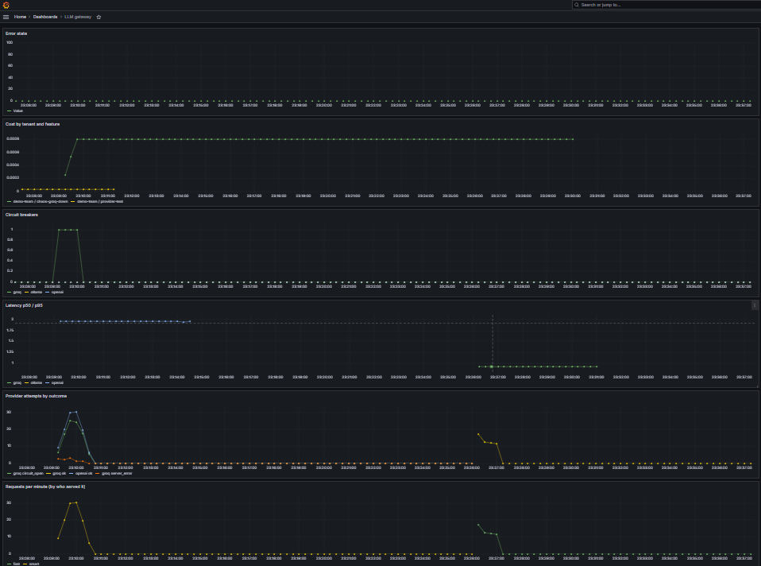
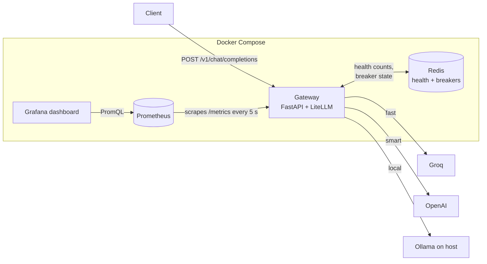

# Self-Healing LLM Gateway

One OpenAI-style endpoint in front of several LLM providers (Groq, OpenAI, and a local Ollama model).
When a provider fails, the gateway **fails over automatically**, **stops calling a broken provider** with a circuit breaker, and **starts using it again on its own** once it recovers. Every request is tagged by team and feature, so cost and reliability can be tracked per tenant on a live Grafana dashboard.

**Headline result:** with one or even two cloud providers down, **100% of requests were still answered**. With everything down, the gateway fails in **about 10 ms** instead of making users wait about 20 seconds.



*Groq is broken on purpose: its circuit breaker opens (0 → 1), traffic moves to OpenAI, the error rate stays at 0%, and Groq takes over again once it is fixed.*

---

## Features

- **One endpoint, many providers.** Clients ask for an alias (`fast`, `smart`, `local`); the gateway maps it to a real model through [LiteLLM](https://github.com/BerriAI/litellm).
- **Required request metadata.** Every request must carry `tenant`, `feature` and `request_id`, so each call can be attributed to a team and feature.
- **Error classification.** Errors are sorted into provider faults (rate limit, timeout, server error, connection error) and client or config errors (bad request, auth, model not found). Only provider faults count against a provider.
- **Health tracking.** Successes, failures and latency per provider are kept in Redis over a rolling 5-minute window.
- **Fallback chain.** Each alias has an ordered list of backups (`fast → smart → local`).
- **Circuit breaker.** After repeated failures, a provider is skipped for 30 seconds, then retried automatically.
- **Observability.** A Prometheus `/metrics` endpoint and a provisioned Grafana dashboard: requests, attempts by outcome, p50/p95 latency, breaker state, cost per tenant and error rate.
- **One-command setup.** `docker compose up` starts the gateway, Redis, Prometheus and Grafana, including the dashboard.

---

## Architecture



### What happens to one request

1. The gateway checks the alias and builds the chain: the requested alias, then its fallbacks.
2. For each step in the chain:
   - **Breaker open?** Skip the provider immediately (`circuit_open`, 0 ms).
   - **Call the provider.** On success: record health, latency, cost and metrics, then return the answer.
   - **On failure:** classify the error and record it. If it's a provider fault, check whether the breaker should open. A `bad_request` stops the chain (it's the client's mistake, and a backup would fail the same way); anything else moves on to the next provider.
3. If every step fails, return `502` with the list of attempts.

---

## Quick start

### Prerequisites

- [Docker Desktop](https://www.docker.com/products/docker-desktop/)
- [Ollama](https://ollama.com/) running on your machine, with the model pulled: `ollama pull llama3.2`
- API keys for [Groq](https://console.groq.com/) and [OpenAI](https://platform.openai.com/)

### Run

```bash
git clone <this-repo-url>
cd LLM_Gateway

# Add your API keys (this file is never committed)
cp .env.example .env
#   then edit .env:
#   OPENAI_API_KEY=...
#   GROQ_API_KEY=...

docker compose up --build
```

| Service | URL |
|---|---|
| Gateway | http://localhost:8000 (API docs at `/docs`) |
| Prometheus | http://localhost:9090 |
| Grafana | http://localhost:3000 (login `admin` / `admin`; dashboard **LLM Gateway**) |

### Try it

```bash
curl http://localhost:8000/v1/chat/completions \
  -H "Content-Type: application/json" \
  -d '{
        "model": "fast",
        "messages": [{"role": "user", "content": "In one sentence, what is a circuit breaker in software?"}],
        "metadata": {"tenant": "demo-team", "feature": "readme-example", "request_id": "123"}
      }'
```

The response is a normal chat completion plus a `gateway` section that shows who actually answered:

```json
"gateway": {
  "served_by": "smart",
  "provider": "openai",
  "latency_ms": 1236,
  "attempts": [
    {"model": "fast", "provider": "groq", "error_category": "server_error", "latency_ms": 10}
  ]
}
```

Or run the test scripts (Python with `httpx` installed):

```bash
python test_providers.py            # one request per alias
python chaos_test.py baseline 20    # 20 requests to "fast", with a latency summary
```

---

## Endpoints

| Method | Path | Purpose |
|---|---|---|
| `POST` | `/v1/chat/completions` | Chat completion with fallback and circuit breaker. `metadata` is required. |
| `GET` | `/health` | Liveness check |
| `GET` | `/providers/health` | Per provider: successes, failures, error rate, p50/p95 latency, breaker state |
| `GET` | `/metrics` | Prometheus metrics |

---

## Configuration

Models and fallbacks live in `config.yaml`:

```yaml
models:
  fast:
    provider: groq
    litellm_model: groq/openai/gpt-oss-20b
    fallbacks: [smart, local]
  smart:
    provider: openai
    litellm_model: openai/gpt-4o-mini
    fallbacks: [fast, local]
  local:
    provider: ollama
    litellm_model: ollama/llama3.2
    api_base: http://localhost:11434
    fallbacks: [fast]
```

Environment variables:

| Variable | Default | Purpose |
|---|---|---|
| `OPENAI_API_KEY`, `GROQ_API_KEY` | — | provider keys (from `.env`) |
| `REDIS_HOST` | `localhost` | set to `redis` in Docker Compose |
| `OLLAMA_API_BASE` | from `config.yaml` | set to `http://host.docker.internal:11434` in Docker, so the container can reach Ollama on the host |

Circuit breaker settings (`breaker.py`): at least **3** requests in the last 5 minutes, error rate **≥ 50%** → open for **30 s**.

---

## Chaos test results

`chaos_test.py` sends 20 requests to the `fast` alias while providers are broken on purpose (by pointing them at an unused port). Latency is measured from the client's side.

| Scenario | Success | Served by | p50 | p95 | Notes |
|---|---|---|---|---|---|
| A. Baseline | 20/20 (100%) | fast ×20 | 479 ms | 616 ms | first request ≈ 2.9 s (connection warm-up) |
| B. Groq down | 20/20 (100%) | smart ×20 | 1228 ms | 6144 ms | breaker opened after 3 failures; then ≈ 1.2 s per request |
| C. Groq + OpenAI down | 20/20 (100%) | local ×20 | 3946 ms | 18084 ms | spikes about every 30 s are the breaker's recovery checks |
| D. Everything down | 0/20 | 502 ×20 | 12 ms | 19838 ms | once all breakers are open, each 502 returns in ≈ 10 ms |

**What this shows:**
- **Failover works:** losing one or two cloud providers doesn't cost a single request.
- **The breaker removes the outage penalty:** in scenario B, only the first 3 requests paid about 6 s; after that, Groq was skipped instantly.
- **Failing fast:** with nothing available, users get an honest error in milliseconds instead of a 20-second hang.

---

## Design decisions

- **Aliases instead of model names.** Clients ask for `fast` or `smart`; providers and models can change in `config.yaml` without touching clients.
- **Only provider faults count against a provider.** A typo in the config (`model_not_found`) or a bad client request must never shut off a healthy provider.
- **Redis for decisions, Prometheus for history.** Redis holds a short, shared 5-minute window that routing and the breaker need *right now*. Prometheus keeps long-term history for people to look at. They do different jobs, so both are used.
- **Breaker state as a Redis key with a TTL.** The breaker is "open" while `breaker:<provider>` exists. Its 30-second expiry *is* the half-open state, so no timer code is needed, and several gateway instances would share the same state.
- **Fail open when Redis is down.** If Redis is unavailable, health tracking and the breaker are skipped and requests still flow. A helper must never break the main job.
- **Minimum request count before tripping.** One failure out of one request is a 100% error rate, but not a broken provider. A provider with recent successes gets some benefit of the doubt.
- **Latency as a histogram.** Buckets (0.25 s to 32 s, matching the measured range) let Prometheus compute correct p50/p95 over any time range.
- **Cost labelled by tenant and feature.** Required metadata makes spend attributable per team and per feature.
- **Secrets injected at runtime.** API keys come from `.env` through Compose's `env_file`, and `.dockerignore` keeps them out of the image.
- **Everything as code.** Pinned dependencies, a cached Dockerfile layer for `pip install` (code-only rebuilds take seconds), and the Grafana data source and dashboard provisioned from files.

---

## Known limitations

- **Tenant is self-reported.** Clients say who they are; real use would need API-key authentication.
- **Error details are passed through.** The 502 response includes provider error categories; raw provider messages should be filtered more strictly before exposing this publicly.
- **Each dead provider costs about 6–7 s** before it's declared failed. A shorter per-provider timeout would reduce this.
- **Recovery checks use real requests.** When the 30-second cooldown ends, one real user request is used to test the provider. A background health probe would avoid that.
- **A Redis outage slows requests.** Not every Redis call uses the skip-after-failure check yet.
- **Latency samples in Redis never expire**, so `/providers/health` can show old latency after a quiet period.
- **Groq cost isn't tracked,** because LiteLLM has no price for this model.
- **Metrics are per process and reset on restart.** With several gateway instances, Prometheus would scrape each one.
- **No retries or request queue.** These were left out of scope.

---

## Project structure

```
LLM_Gateway/
├── main.py              # FastAPI app: routing, fallback chain, breaker checks, metrics, /metrics
├── errors.py            # classify_error(): provider faults vs client/config errors
├── health.py            # Redis: per-minute success/failure counters, latency samples, get_health()
├── breaker.py           # circuit breaker: is_open(), maybe_trip()
├── metrics.py           # Prometheus counters, histogram and gauge
├── config.yaml          # aliases, providers, fallbacks
├── test_providers.py    # one request per alias
├── chaos_test.py        # load + latency summary for chaos scenarios
├── Chaos_result.md      # recorded chaos test results
├── Dockerfile
├── docker-compose.yml   # gateway, Redis, Prometheus, Grafana
├── prometheus.yml       # Prometheus scrape config
├── requirements.txt     # pinned dependencies
├── grafana/
│   ├── provisioning/
│   │   ├── datasources/prometheus.yml
│   │   └── dashboards/dashboards.yml
│   └── dashboards/llm-gateway.json
└── docs/
    └── dashboard-outage.png
```

---

## Tech stack

Python 3.13 · FastAPI · LiteLLM · Redis (redis-py asyncio) · Prometheus (prometheus-client) · Grafana · Docker Compose · Groq · OpenAI · Ollama

---

## Author

Built by **Srikar Maddala**, step by step, as a learning project.    [LinkedIn](https://www.linkedin.com/in/srikar-maddala-123456/)· [GitHub](https://github.com/srikar-maddala)